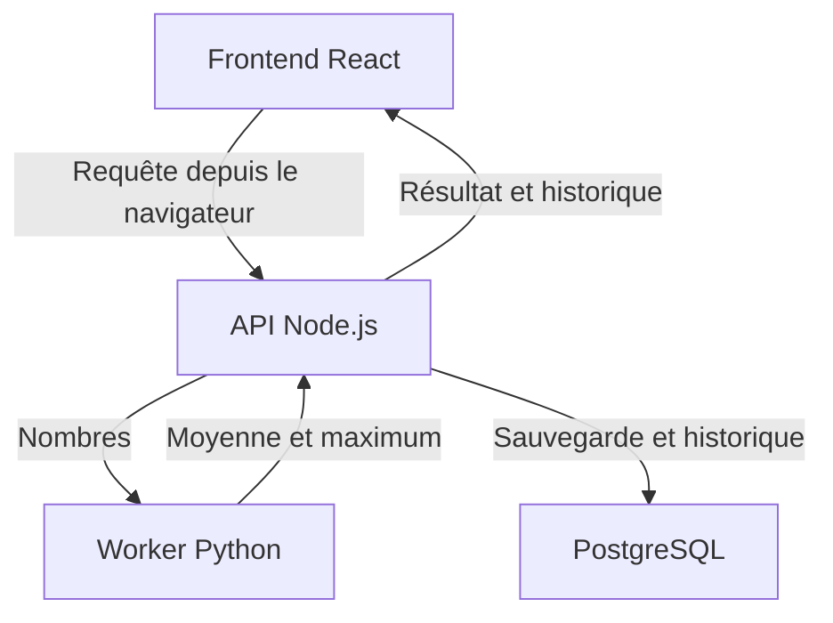

# EcoTrack Analytics

Une organisation souhaite analyser des séries de mesures et conserver les résultats. Depuis une page React, l’utilisateur lance un calcul. L’API Node.js demande au service Python de calculer la moyenne et le maximum, puis enregistre le résultat dans PostgreSQL. La page affiche le résultat et l’historique.



Le JavaScript React s’exécute dans le navigateur. Le conteneur frontend sert les fichiers de la page. Le navigateur appelle localhost:5000 ; dans Docker, l’API contacte worker et db par leur nom de service.

## Votre mission

### 1. Identifier les services

| Dossier ou service | Technologie | Commande de lancement | Port |
|---|---|---|---|
| frontend | React et serveur Node.js | npm run build puis npm start | 3000 |
| api | Node.js Express | npm start | 5000 |
| worker | Python Flask | python app.py | 8000 |
| db | Image postgres:15-alpine | À configurer dans Compose | 5432 interne |


### 2. Tester Python avec un venv

À la racine du dépôt, l’environnement virtuel est créé dans `.venv` et les dépendances du worker sont dans `worker/requirements.txt`.

Windows PowerShell :

```powershell
py -m venv .venv
.\.venv\Scripts\Activate.ps1
python -m pip install -r worker\requirements.txt
python worker\app.py
```

Linux ou macOS :

```bash
python3 -m venv .venv
source .venv/bin/activate
python -m pip install -r worker/requirements.txt
python -c "import sys; print(sys.executable)"
python worker/app.py
```

Le chemin Python affiché doit contenir `.venv`. Ouvrir http://localhost:8000/health : résultat attendu `{"status":"ok"}`. Arrêter le serveur avec `Ctrl+C`.


### 3. Créer les images

Chaque service possède son Dockerfile et son `.dockerignore`. Le frontend est compilé dans une étape de build puis servi par un conteneur Node.js. Construire les images :

```bash
docker compose build
```

### 4. Configurer Compose

`compose.yaml` déclare les quatre services, les contrôles de santé et les dépendances de démarrage. `reseau_public` relie le frontend à l’API ; `reseau_interne` relie l’API, le worker et PostgreSQL et n’est pas accessible depuis l’extérieur. Seuls les ports 3000 et 5000 sont publiés. Le volume `pg_data` conserve les données PostgreSQL.

Vérifier la configuration :

```bash
docker compose config -q
```

### 5. Ajouter le secret

Le fichier local `db_password.txt` est fourni à PostgreSQL et à l’API comme secret Docker. Pour un nouveau clone, créer ce fichier avant le démarrage (ne jamais le committer) :

```bash
printf '%s' 'choisir-un-mot-de-passe-local' > db_password.txt
```

Utiliser un mot de passe local non réutilisé. Le fichier est exclu par `.gitignore`. L’API et PostgreSQL lisent le secret depuis `/run/secrets/db_password` ; ne pas passer le mot de passe en clair dans `compose.yaml`.

### 6. Lancer et vérifier

À la racine :

```bash
docker compose config -q
docker compose up -d --build
docker compose ps -a
```

Ouvrir http://localhost:3000 pour l’interface. Vérifier les services et envoyer une analyse :

```bash
curl http://localhost:5000/health
curl http://localhost:5000/status
curl -X POST http://localhost:5000/analyze \
  -H 'Content-Type: application/json' \
  -d '{"numbers":[10,20,30]}'
curl http://localhost:5000/history
```

Le worker n’expose pas de port sur l’hôte ; son endpoint de santé est vérifié depuis le conteneur avec `docker compose exec worker python -c "import urllib.request; print(urllib.request.urlopen('http://127.0.0.1:8000/health').read().decode())"`. Les résultats attendus sont `{"status":"ok"}` pour l’API, puis `{"api":"ok","db":"ok","worker":"ok"}` pour `/status`. L’analyse de `[10,20,30]` doit donner une moyenne de `20` et un maximum de `30`, puis apparaître dans l’historique.

Pour vérifier la persistance, arrêter puis relancer sans supprimer le volume :

```bash
docker compose down
docker compose up -d
curl http://localhost:5000/history
```

Le résultat précédent doit toujours être présent. Ne pas ajouter `-v` à `docker compose down` sauf si vous souhaitez supprimer les données.

Pour vérifier l’isolation réseau, consulter `docker compose config` : le frontend est uniquement sur `reseau_public`, PostgreSQL et le worker uniquement sur `reseau_interne`, et l’API sur les deux. L’API doit déclarer les trois services `ok` dans `/status`. Aucun port PostgreSQL ou worker ne doit apparaître dans `docker compose ps`.

Pour vérifier le secret sans afficher sa valeur :

```bash
docker compose exec api sh -c 'test -r "$POSTGRES_PASSWORD_FILE" && echo "secret lisible par l’API"'
```

Le démarrage de PostgreSQL et le résultat `db:"ok"` dans `/status` confirment également son utilisation par la base.

Si nécessaire :

```bash
docker compose logs api
docker compose logs worker
docker compose logs db
docker compose logs frontend
```

### 7. Compléter le dépôt et remettre

Inclure le code fourni, les trois Dockerfiles, les trois `.dockerignore`, `compose.yaml`, `worker/requirements.txt`, `.gitignore` et ce README complété.

Informations de remise :

- **Étudiant :** Clément BOUNAIX.
- **Groupe :** B2.
- **Lancement :** `docker compose up -d --build`.
- **Arrêt :** `docker compose down` (conserve les données).

### Endpoints fournis

| Service | Méthode et chemin | Rôle |
|---|---|---|
| worker | GET /health | Vérifier Python |
| worker | POST /analyze | Recevoir {"numbers":[10,20,30]} et calculer |
| api | GET /health | Vérifier le processus Node.js |
| api | GET /status | Vérifier PostgreSQL et worker |
| api | POST /analyze | Calculer via Python et enregistrer |
| api | GET /history | Lire les 50 derniers résultats |

### 8. Preuves de fonctionnement

Sorties obtenues avec `docker compose up -d --build` le 26 novembre 2026. La valeur du secret n’est jamais affichée.

**État des services**

```text
$ curl -fsS http://localhost:5000/health
{"status":"ok"}

$ curl -fsS http://localhost:5000/status
{"api":"ok","db":"ok","worker":"ok"}

$ docker compose exec -T worker python -c "import urllib.request; print(urllib.request.urlopen('http://127.0.0.1:8000/health').read().decode())"
{"status":"ok"}
```

**Analyse et enregistrement**

```text
$ curl -fsS -X POST http://localhost:5000/analyze -H 'Content-Type: application/json' -d '{"numbers":[10,20,30]}'
{"id":4,"numbers":[10,20,30],"average":20,"maximum":30,"created_at":"2026-11-26T10:57:16.454Z"}
```

L’entrée `id: 4` apparaît dans `/history` avant et après le redémarrage :

```json
{"id":4,"numbers":[10,20,30],"average":20,"maximum":30,"created_at":"2026-11-26T10:57:16.454Z"}
```

Après `docker compose restart`, `/status` renvoie encore :

```json
{"api":"ok","db":"ok","worker":"ok"}
```

**Réseaux et ports**

```text
$ docker compose config -q
# Code de sortie : 0

$ docker network inspect projetecotrack_reseau_interne projetecotrack_reseau_public --format '{{.Name}} internal={{.Internal}} containers={{range .Containers}}{{.Name}} {{end}}'
projetecotrack_reseau_interne internal=true containers=projetecotrack-api-1 projetecotrack-db-1 projetecotrack-worker-1
projetecotrack_reseau_public internal=false containers=projetecotrack-api-1 projetecotrack-frontend-1
```

Dans `docker compose ps -a`, seuls les ports frontend `3000` et API `5000` sont publiés sur l’hôte. PostgreSQL (`5432/tcp`) et worker (`8000/tcp`) n’ont pas de correspondance vers un port hôte.

**Lecture du secret sans révéler sa valeur**

```text
$ docker compose exec -T api sh -c 'test -r "$POSTGRES_PASSWORD_FILE" && echo "secret lisible par l’API"'
secret lisible par l’API
```
